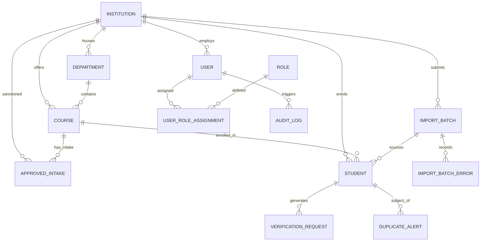

# APAAR-Vault Database Schema & Entity Relationships

The relational schema is implemented with SQLAlchemy 2.0 with full support for PostgreSQL and SQLite.

---

## 1. Entity-Relationship Diagram (Mermaid)

---

## 2. Table Specifications

### 2.1 `institutions`
- `id` (VARCHAR(36), PK): UUID.
- `institution_code` (VARCHAR(50), Unique, Indexed): Official AICTE/State institutional identifier.
- `name` (VARCHAR(255)): Official institution name.
- `aicte_approval_ref` (VARCHAR(100)): Sanction order reference.
- `institution_type` (VARCHAR(50)): Govt, Govt-Aided, Private, Autonomous.
- `state` (VARCHAR(100), Indexed), `district` (VARCHAR(100)).
- `contact_email` (VARCHAR(255)), `contact_phone` (VARCHAR(20)).
- `status` (VARCHAR(30)): `APPROVED`, `PENDING`, `UNDER_REVIEW`.
- `is_simulated` (BOOLEAN): Explicit demonstration badge flag.

### 2.2 `users` & `roles`
- `users`: `id`, `email` (Unique), `hashed_password` (Bcrypt), `full_name`, `phone_number`, `is_active`, `institution_id` (FK to institutions, nullable for national admins).
- `roles`: `id`, `name` (`SUPER_ADMIN`, `AICTE_ADMIN`, `INSTITUTION_ADMIN`, `DEPT_COORDINATOR`, `DATA_ENTRY`, `STUDENT`, `EXTERNAL_VERIFIER`).
- `user_role_assignments`: `user_id`, `role_id` (Unique compound constraint).

### 2.3 `courses` & `approved_intakes`
- `courses`: `id`, `institution_id` (FK), `department_id` (FK), `course_name`, `course_code`, `degree_level` (UG/PG), `duration_years`.
- `approved_intakes`:
  - `id` (PK)
  - `institution_id` (FK), `course_id` (FK), `academic_year` (e.g., "2024-2025")
  - `approved_intake` (INT): Sanctioned intake seats
  - `supernumerary_quota` (INT): EWS, TFW, PMSSS seats
  - `actual_enrolment` (INT): Total confirmed student enrolments
  - `supernumerary_enrolled` (INT): Enrolled supernumerary students
  - Compound unique constraint: `(institution_id, course_id, academic_year)`.

### 2.4 `students`
- `id` (VARCHAR(36), PK): Internal UUID.
- `institution_id` (FK), `course_id` (FK).
- `student_name` (VARCHAR(200)).
- `institution_reg_num` (VARCHAR(100), Indexed): Roll number / registration ID.
- `apaar_id` (VARCHAR(50), Indexed): Masked in UI & logs (`SIM-APAAR-****-984210`).
- `academic_year`, `admission_year`, `admission_status` (`ACTIVE`, `COMPLETED`, `TRANSFERRED`).
- `admission_category` (`GENERAL`, `OBC`, `SC`, `ST`, `EWS`).
- `is_supernumerary` (BOOLEAN), `supernumerary_category`.
- `apaar_status` (`NOT_CHECKED`, `FORMAT_VALID`, `VERIFIED`, `INVALID`, `PENDING`, `SERVICE_UNAVAILABLE`, `MANUAL_REVIEW_REQUIRED`).
- `data_validation_status` (`VALID`, `WARNING`, `ERROR`, `UNDER_REVIEW`).

### 2.5 `duplicate_alerts`
- `id` (PK)
- `student_id` (FK), `matched_student_id` (FK).
- `institution_a_id` (FK), `institution_b_id` (FK).
- `match_category`: `CROSS_INSTITUTION_ENROLMENT`, `EXACT_APAAR_CONFLICT`, `SAME_INSTITUTION_REG_DUPLICATE`.
- `severity`: `CRITICAL`, `HIGH`, `MEDIUM`.
- `reason` (TEXT), `apaar_masked` (VARCHAR(50)).
- `status`: `NEW`, `UNDER_REVIEW`, `CONFIRMED_DUPLICATE`, `NOT_A_DUPLICATE`, `RESOLVED`.
- `resolution_notes` (TEXT), `assigned_reviewer_id` (FK).

### 2.6 `verification_requests`
- `id` (PK)
- `verification_code` (VARCHAR(64), Unique): Secure token reference.
- `student_id` (FK).
- `verifier_name`, `verifier_organization`, `purpose`.
- `status`: `VERIFIED`, `NOT_VERIFIED`, `EXPIRED`, `REVOKED`, `REVIEW_REQUIRED`.
- `expires_at` (DATETIME).
